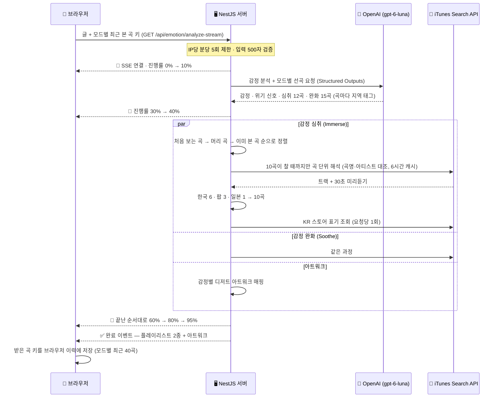

<div align="center">
  
  <h3>감정에 따른 음원 추천 서비스</h3>
  <p>
    당신의 하루, 당신의 감정을 텍스트로 들려주세요.<br/>
    <strong>AI(OpenAI)</strong>가 분석한 감정에 맞춰 <strong>음악(iTunes Search API)</strong>과 <strong>디저트 아트워크</strong>를 선물합니다.
  </p>
  <p>
    👉 <a href="https://om-artune.vercel.app"><strong>om-artune.vercel.app</strong></a>
  </p>

  <br/>

  <p>
    
    
    
    
    
    
    
  </p>
</div>

## 📖 프로젝트 소개

**Artune**은 사용자가 입력한 일기나 짧은 텍스트를 분석하여, 현재 감정 상태에 가장 적합한 음악 플레이리스트와 시각적 즐거움을 주는 픽셀 아트 디저트를 제공하는 웹 서비스입니다.

단순 음악 추천이 아닌 감정을 **더 깊이 느끼고 싶을 때(Immerse)** 와 **전환하고 싶을 때(Soothe)** 두 가지 선택지를 제공합니다.

## 🌟 핵심 기능

- **AI 감정 분석 & 직접 선곡**: OpenAI(`gpt-6-luna`)가 글을 12가지 감정 중 하나로 분류하고, 모드별로 어울리는 곡을 직접 고릅니다(심취 12곡 · 완화 15곡). 응답은 Structured Outputs(JSON 스키마)로 받아 형태를 보장합니다.
- **Dual Mode Playlist**:
  - 🎶 **감정 심취 (Immerse)**: 슬플 땐 더 슬픈 음악으로, 기쁠 땐 더 신나는 음악으로 감정을 극대화합니다.
  - 🌿 **감정 완화 (Soothe)**: 지금 감정에서 출발해 차분한 쪽으로 옮겨 가도록 고릅니다. 격한 감정은 가라앉히고, 우울한 기분은 산뜻하게 전환합니다.
- **곡 단위 해석**: 고른 곡을 iTunes Search API에서 곡명·아티스트를 모두 대조해 찾고(커버·MR·엉뚱한 곡은 버림), 한국 6 · 팝 3 · 일본 1 비율로 모드당 10곡을 채웁니다. 10곡이 차면 해석을 멈춰 iTunes 호출 한도(약 20회/분)를 아낍니다.
- **본 곡은 뒤로**: 로그인 없이 브라우저에 모드별로 최근 본 40곡을 기억해 두고, 다음 추천에서는 처음 보는 곡부터 채웁니다. 여러 사람의 화면에 반복해서 나오는 곡(머리 곡)도 뒤로 미룹니다.
- **인터랙티브 음악 청취**:
  - 곡마다 **30초 미리듣기**를 제공합니다. PC는 커버에 마우스를 올리면, 모바일은 곡을 탭하면 재생됩니다.
  - **CD 인터랙션**: PC에서는 재생할 때 CD가 커버 안으로 들어가고, 멈출 때는 볼륨이 서서히 줄어들며(fade-out) 멈춥니다.
- **감정 맞춤 아트워크**: 감정마다 디저트 픽셀 아트를 보여 줍니다. Gemini로 미리 만든 이미지이며, DALL·E 실시간 생성은 비용 때문에 멈췄습니다.
- **실시간 분석 경험**: Server-Sent Events(SSE)로 감정 분석 → 음악 탐색 → 아트워크 준비의 진행 상황을 프로그레스 바로 보여 줍니다.
- **안전과 표기**:
  - 글에서 위기 신호(자해·자살 의도)가 보이면 추천 위에 상담 전화(109) 안내를 띄웁니다.
  - 입력·결과 화면 맨 아래에 생성형 AI를 쓴다는 사실을 알립니다.
  - 열린 곡에 Apple Music 배지와 iTunes 출처("provided courtesy of iTunes")를 표기합니다.
  - IP당 분당 5회로 요청을 제한합니다.

## 🏗️ 시스템 아키텍처

사용자의 텍스트가 어떻게 음악과 이미지로 변환되는지 보여주는 데이터 흐름도입니다.  
**Server-Sent Events (SSE)** 로 각 단계가 끝날 때마다 진행률을 보내고, 심취·완화·아트워크는 병렬로 준비합니다.



## 🛠 기술 스택

### Architecture

- **Monorepo**: Turborepo (Frontend/Backend 패키지 통합 관리)
- **Package Manager**: npm Workspaces
- **Shared Types**: `packages/shared-types` (프론트·백 응답 타입 공유)
- **Runtime**: Node.js 24

### Frontend (`apps/frontend`)

- **Core**: React 19, Vite 7, TypeScript
- **State Management**: Zustand 5 (요청·취소·결과 상태와 비동기 액션)
- **Styling**: Emotion (CSS-in-JS), Framer Motion (애니메이션)
- **Testing**: Vitest, React Testing Library (컴포넌트·스토어·API)
- **Deploy**: Vercel

### Backend (`apps/backend`)

- **Core**: NestJS 11 (Module 기반 아키텍처)
- **Language**: TypeScript (strictNullChecks 활성화)
- **External APIs**:
  - **OpenAI Chat Completions API**: 감정 분석 + 모드별 선곡 (Structured Outputs)
  - **iTunes Search API**: 곡 검색 · KR 스토어 표기 조회 · 30초 미리듣기
- **Caching**: NestJS CacheModule (곡 해석 결과 6시간, 차단·네트워크 오류는 캐시하지 않고 다음 요청에서 재시도)
- **Rate Limit**: `@nestjs/throttler` (IP당 분당 5회, Railway가 넣는 `X-Real-IP` 기준)
- **Testing**: Jest (서비스·유틸 단위 테스트, 요청 제한은 실제 HTTP 요청으로 검증)
- **Protocol**: HTTP, SSE (Server-Sent Events)
- **Deploy**: Railway (Railpack)

## 📱 UI/UX 미리보기

> 아래 화면은 Apple Music 배지와 하단 고지를 넣기 전 버전입니다.

|                     감정 입력 및 로딩 (SSE)                      |                         결과 페이지 (PC View)                          |                                    모바일/태블릿 반응형                                     |
| :--------------------------------------------------------------: | :--------------------------------------------------------------------: | :-----------------------------------------------------------------------------------------: |
|  |  |  |
|                     실시간 분석 진행률 표시                      |                    아트워크와 플레이리스트 분할 뷰                     |                               토글형 뷰 전환 & 터치 인터랙션                                |

## ⚙️ 설치 및 실행

이 프로젝트는 Turborepo를 사용하고 있습니다. 루트 디렉토리에서 한 번의 명령어로 전체 프로젝트를 실행할 수 있습니다.

### 0. 요구 사항

- **Node.js 24** (`package.json`의 `engines: 24.x`) — nvm을 쓴다면 `nvm install 24 && nvm use 24`
- OpenAI API 키

### 1. 환경 변수 설정 (.env)

#### Backend (`apps/backend/.env`)

```env
PORT=3000
OPENAI_API_KEY=your_openai_key
# 배포 환경(NODE_ENV=production)에서만 쓰는 값: 추가로 허용할 프론트엔드 주소
# FRONTEND_URL=https://your-frontend.example.com
```

#### Frontend (`apps/frontend/.env`)

```env
# 끝에 /api를 붙이지 않습니다 — 요청 경로(/api/emotion/...)에 이미 들어 있습니다
VITE_API_BASE_URL=http://localhost:3000
```

### 2. 패키지 설치

```bash
npm install
```

### 3. 개발 서버 실행 (Frontend + Backend)

```bash
npm run dev

# Frontend: http://localhost:5173
# Backend:  http://localhost:3000
```

### 4. 테스트

```bash
npm run test --workspace=backend          # Jest
npm run test --workspace=frontend -- --run # Vitest (한 번 실행)
```

## 📂 프로젝트 구조

```
artune/
├── apps/
│   ├── backend/                    # NestJS Server
│   │   ├── src/
│   │   │   ├── emotion/            # 요청 흐름 · SSE · 입력 검증 (Core)
│   │   │   ├── openai/             # 선곡 프롬프트 · 응답 스키마
│   │   │   ├── music/              # 지역 쿼터 · 본 곡 후순위 · 노출 기록(머리 곡)
│   │   │   ├── itunes/             # 곡 해석(곡명·아티스트 대조) · KR 표기 · 캐시 · rate limit 처리
│   │   │   ├── dalle/              # 감정별 아트워크 매핑 (DALL·E 호출은 정지)
│   │   │   └── throttle.config.ts  # IP당 요청 제한
│   │   └── scripts/eval/           # 선곡 품질 측정 프로브
│   └── frontend/                   # React Client
│       └── src/
│           ├── components/         # AlbumCard · AlbumGrid · AlbumHoverModal · MobilePlayerModal · PreviewSource 등
│           ├── hooks/              # useAudioScratch · useMediaQuery · useHover 등
│           ├── stores/             # Zustand Store (요청 · 취소 · 결과)
│           ├── api/                # SSE 연결
│           ├── utils/              # 본 곡 이력(localStorage) · 입력 검증
│           ├── constants/          # 고지 문구 등
│           └── pages/
├── packages/
│   └── shared-types/               # 프론트·백 공유 응답 타입
├── docs/measurements/              # 측정 기록
├── package.json
└── turbo.json
```

## 💡 주요 기술적 고민

### 1. Spotify 정책 변경 대응 — iTunes Search API 완전 이전

> 7월, 초기 아티스트 기반 버전의 작업입니다. 추천 구조는 이후 **아티스트 기반 → Last.fm 유사곡 하이브리드(7월) → AI 직접 선곡(11월)** 으로 바뀌었습니다.

Spotify API 정책 변경(Developer Mode 유저 제한, Premium 강제)에 대응해 음악 추천 파이프라인을 iTunes Search API로 완전 이전했습니다.

- **LLM 큐레이션 전환**: 오디오 피쳐(valence/energy/tempo) 기반 필터링 대신, GPT가 감정·모드별 아티스트 풀을 직접 큐레이션하는 구조로 재설계. 추천 요청당 Spotify API 호출 65회 전부 제거.
- **Rate Limit 방어**: 429/403을 상태별로 판별해 국가 폴백의 호출 증폭(최대 3배)을 차단하고, 일시적 차단 결과가 캐시에 남는 문제를 수정. throttle 상황에서도 트랙 수율 20/20 유지.

### 2. 측정 기반 응답시간 최적화 (17.9초 → 11.6초, -35%)

> 초기 아티스트 기반 버전(7월) 기준 수치입니다. 지금 구조(AI 직접 선곡)에서는 다시 측정할 예정입니다.

단계별 타이밍 계측을 심어 병목을 실측으로 식별한 뒤 최적화했습니다. ([원본 로그](./docs/measurements/2026-07-21-response-timing.log))

| 단계 | 응답시간 | 조치 |
| :-- | :-- | :-- |
| Baseline | 17.9s | LLM 52% + iTunes 순차 호출 48%로 병목 분해 |
| SSE 병렬화 | ~13.8s | iTunes 구간 8.6s → 4.5s. 완료 카운트 기반 마일스톤으로 진행률 단조 증가 보장 |
| LLM 출력 축소 | **11.6s** | 아티스트 40→25명/모드로 출력 토큰 절감 (수율 20/20 유지 검증) |

### 3. 오디오 UX 디테일 (HTMLAudioElement & Interaction)

- 단순한 play/pause가 아닌, 판을 천천히 멈추는 듯한 경험을 주기 위해 커스텀 훅(`useAudioScratch`)을 구현했습니다.
- `requestAnimationFrame`으로 프레임마다 볼륨을 줄여 페이드아웃한 뒤 멈춥니다. 호버를 풀면 0.5초로 짧게 줄입니다.
- 탭이 가려지면 바로 멈추고, 이벤트 리스너와 타이머를 정리합니다.

### 4. 반응형 디자인과 Glassmorphism

- Emotion을 활용해 세련된 Dark Glassmorphism 테마를 구축했습니다.
- PC에서는 한 화면에 아트워크와 리스트를, 모바일에서는 토글 방식을 적용하여 디바이스별 최적화된 레이아웃을 제공합니다.

## 기여자

- 이세민 ([@smnm1998](https://github.com/smnm1998))
